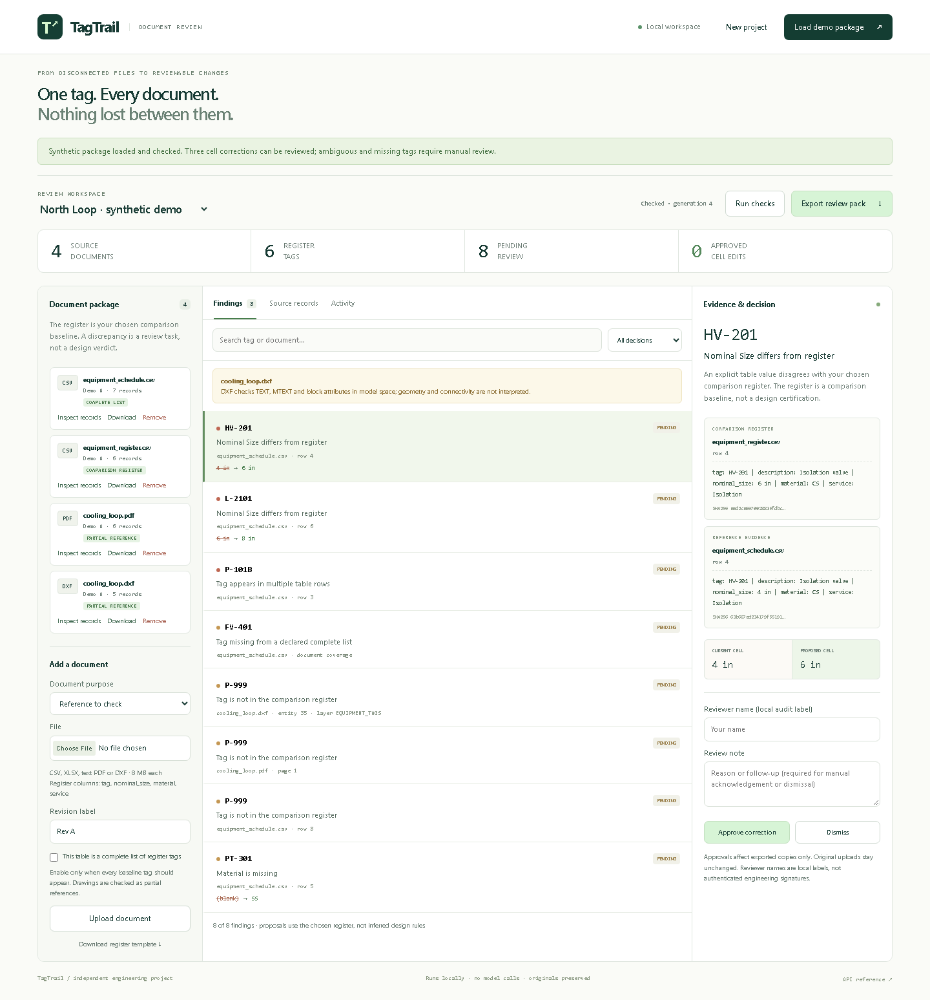

# TagTrail

[](https://github.com/swaroopv4/tagtrail/actions/workflows/check.yml)

**Find the mismatch. Follow the evidence. Export the reviewed correction.**

TagTrail is a working local application for comparing an equipment register with schedules and tags extracted from engineering drawings. It turns a disagreement into a source-linked review item, then produces corrected copies only for approved cell changes.

I built it after reading about [Verno's engineering-document workflows](https://www.verno-ai.com/). The narrow problem I chose was reconciling a project package without losing the source of a value or silently applying an uncertain edit. This is an independent project, not a Verno product or integration.



**[Watch the actual browser walkthrough](docs/walkthrough.webm)** · **[Inspect a real exported review pack](docs/example-review-pack.zip)** · **[Architecture](docs/ARCHITECTURE.md)** · **[Verification](docs/VALIDATION.md)**

## What works

- Upload an equipment register in **CSV or XLSX** and reference tables, selectable-text **PDFs**, or text-bearing **DXF drawings**.
- Extract tags with physical row, worksheet, PDF-page or DXF-entity locations.
- Find mismatched sizes, materials and services, blank values, duplicate table tags, unregistered tag candidates and omissions from explicitly complete lists.
- Compare the original evidence with the chosen register, including each file's SHA256.
- Approve a specific cell correction, dismiss it with a reason, or acknowledge an ambiguity for manual investigation.
- Export a ZIP containing untouched originals, approved CSV/XLSX copies, findings, audit events and a hash manifest.
- Reload the browser or restart the app without losing projects and decisions.

All parsing, reconciliation, storage and exports run on the Python backend. The UI calls the same API used by the workflow tests. No API key or model service is needed.

## Run it

### Docker

```sh
git clone https://github.com/swaroopv4/tagtrail.git
cd tagtrail
docker compose up --build
```

Open **http://localhost:8000**, then click **Load demo package**. SQLite data persists in the named Docker volume. The published port is bound to the local machine.

### Python 3.11 or 3.12

Windows PowerShell, without activating a script:

```powershell
python -m venv .venv
.\.venv\Scripts\python.exe -m pip install -e ".[dev]"
.\.venv\Scripts\python.exe -m uvicorn tagtrail.app:app --host 127.0.0.1 --port 8000
```

macOS or Linux:

```sh
python3 -m venv .venv
.venv/bin/python -m pip install -e '.[dev]'
.venv/bin/python -m uvicorn tagtrail.app:app --host 127.0.0.1 --port 8000
```

The app has no frontend build step. The `dev` extra adds tests and demo-generation tools; `pip install .` is sufficient for the application itself.

## Two-minute demo

1. Click **Load demo package**. The app imports four real synthetic files: a register, an inconsistent schedule, a PDF and a DXF. It runs the checker, producing **eight findings**.
2. Select **HV-201**. The schedule says `4 in`; the chosen register says `6 in`. Both original rows and hashes appear beside the proposal.
3. Enter a reviewer name and approve that correction.
4. Inspect **P-101B**. It is duplicated in the schedule, so the app deliberately offers no automatic cell edit. Missing or unknown tags also require manual review.
5. Click **Export review pack**. Open the reviewed schedule: HV-201 is corrected, while unapproved cells, the duplicate and the unknown row remain unchanged.
6. Upload another source. The previous run becomes stale, and export is disabled until checks run again. Earlier decisions cannot authorize changes against a new package.

There are **three editable cell proposals** in the demo: HV-201 size, L-2101 size and PT-301 material. Drawing-tag findings are review items, not automatic CAD edits.

The downloadable [example pack](docs/example-review-pack.zip) was generated through the UI after approving **only HV-201**. It is not a hand-written example export.

## Use your own files

Create a project, upload one comparison register, then add reference documents. A new register replaces the active baseline and invalidates the existing run.

```csv
tag,description,nominal_size,material,service
P-101,Main pump,6 in,CS,Cooling water
HV-201,Isolation valve,6 in,CS,Isolation
```

- `tag` is required; `nominal_size`, `material` and `service` are optional compared columns. Extra columns are preserved in exported copies.
- Each workbook must contain one worksheet. Row 1 must have unique headers, with no merged headers or formulas. Supply values-only exports.
- Table tags such as `P101` normalize to `P-101`. Text extraction recognizes hyphenated forms such as `P-101` and `PT-301`. Drawings with other naming conventions need a parser extension.
- Case and whitespace differences, plus simple inch spellings such as `6"` and `6 inches`, are normalized. **DN/NPS conversion, alloy equivalence and engineering suitability are not inferred.**
- Only mark a table **complete** if every baseline tag should occur. Partial references and drawings do not generate absent-tag findings.
- Limits: 8 MB per file, 32 MB of active files per project, 20 active documents, 5,000 table rows, 50 columns and 60 PDF pages.

Download a template from the sidebar. Additional synthetic files, including an XLSX schedule, are in [`tagtrail/samples`](tagtrail/samples).

## Important boundaries

The comparison register is a user-selected baseline, not proof of the correct design. TagTrail checks explicit values and recognizable labels; it does not interpret piping connectivity, drawing symbols, geometry, process safety or engineering standards. Scanned PDFs without selectable text produce warnings; OCR is not implemented. Native DWG is not supported.

PDF and DXF drawing files are never edited. Approved corrections change only existing, unambiguous CSV/XLSX cells in exported copies. Missing rows and unknown tags are never invented or deleted. Original bytes remain unchanged.

This is a single-user local workbench. Reviewer names are audit labels, not authenticated signatures. It has no login or multi-tenant authorization and should remain bound to localhost. There are no external model calls, hidden telemetry or cloud uploads. Review [the design notes](docs/ARCHITECTURE.md) before extending it to shared use.

## Verify it

```sh
python -m pip install -e '.[dev]'
python -m ruff check tagtrail scripts tests
python -m ruff format --check tagtrail scripts tests
python -m pytest -q
python -m playwright install chromium
python scripts/browser_check.py
```

On Windows use `.\.venv\Scripts\python.exe` in place of `python` if the environment is not activated. If your system's pytest temporary directory is restricted, create `test-results` and use `pytest --basetemp test-results/local-run`.

The browser test starts its own isolated server and database, uploads actual files through the UI, approves and downloads a correction, checks ZIP contents, tests refresh persistence and mobile layout, and exercises invalid input. `--record` refreshes the synthetic screenshots and video in `docs`.

GitHub Actions runs Python checks on 3.11 and 3.12 and a separate Chromium workflow. See [the recorded validation scope](docs/VALIDATION.md) for what was actually run locally.

## Project layout

```text
tagtrail/app.py          HTTP API, review state and stale-run protection
tagtrail/parsers.py      CSV, XLSX, PDF and DXF extraction
tagtrail/engine.py       Deterministic reconciliation and bounded proposals
tagtrail/exports.py      Approved copies and traceable review packs
tagtrail/storage.py      SQLite transactions and audit history
tagtrail/static/         Working browser interface
tagtrail/samples/        Synthetic input files
tests/                  Parser, rules and workflow regression tests
scripts/browser_check.py Full browser workflow and recording
```

Built by [Venkat Swaroop Veerla](https://github.com/swaroopv4). AI-assisted development was used; the implementation, tests, constraints and review decisions are documented so the work can be examined rather than taken on trust.
